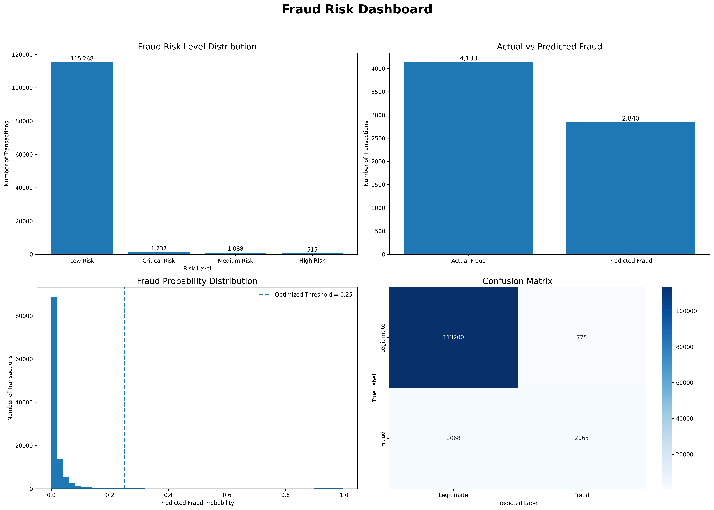

# Fraud Detection & Financial Risk Analysis
## About the Project
Financial fraud is a growing challenge for businesses that handle large numbers of digital transactions. In this project i used transaction and identity data to explore patterns linked to fraudulent activity and build a machine learning model for fraud detection and risk assessment.
I worked through the project from data cleaning and SQL analysis to feature engineering, model building, evaluation and visualization. The main goal was to see how transaction data could be used to identify suspicious activity and help prioritize transactions that may need further investigation.
## Research Question
**How can transaction and identity data be used to identify potentially fraudulent transactions and support more effective financial risk management?**
## What I Did
- Cleaned and prepared the transaction and identity datasets.
- Used **SQL with DuckDB** to explore the data and identify useful patterns.
- Created new features to capture transaction and customerrelated patterns.
- Prepared the data for machine learning while taking the imbalance between fraudulent and legitimate transactions into account.
- Built and compared machine learning models.
- Evaluated the models using precision, recall, F1-score, ROC-AUC and a confusion matrix.
- Tuned the classification threshold to improve fraud detection.
- Looked at feature importance to understand which variables contributed most to the model's predictions.
- Created fraudrisk categories and a dashboard to make the results easier to interpret.
## Tools Used
**Python | Pandas | NumPy | Scikit-learn | SQL | DuckDB | Matplotlib | Seaborn | Google Colab**
## Machine Learning
I tested two machine learning approaches:
- **SGD Classifier**
- **HistGradientBoosting Classifier**
The HistGradientBoosting model performed much better and was selected for the final analysis.
Because fraudulent transactions were much less common than legitimate transactions i focused on metrics such as precision, recall, F1-score and ROC-AUC rather than accuracy alone.
## Final Model Results
After tuning the classification threshold, the final HistGradientBoosting model achieved:
| Metric          | Result |
| --------------- | -----: |
| Accuracy        |  98.0% |
| Fraud Precision |  72.7% |
| Fraud Recall    |  50.0% |
| Fraud F1-Score  |  59.2% |
| ROC-AUC         |  0.914 |
| PR-AUC          |  0.605 |
The classification threshold was adjusted to **0.25** to achieve a better balance between detecting fraudulent transactions and limiting false positives.
## Feature Importance
I also looked at feature importance to understand which variables had the strongest influence on the model's predictions.
Some of the important features included:
- C1
- C13
- C14
- id_17
- card1
- C7
- TransactionAmt
- card5
- id_20
- V69
- email_domain_length
## Fraud Risk Dashboard
The final dashboard brings the main results together and includes:
Fraud risk level distribution
- Actual vs predicted fraud
- Fraud probability distribution
- Confusion matrix
- Fraud-risk categories ranging from Low Risk to Critical Risk
This makes it easier to see how the model is performing and where higher-risk transactions may need further attention.
## Key Takeaways
The analysis showed that transaction data can provide useful signals for identifying potentially fraudulent activity.The final model was able to identify a meaningful proportion of fraudulent transactions while maintaining reasonably high precision. The results also showed why threshold selection matters in fraud detection, where missing fraudulent transactions and incorrectly flagging legitimate transactions both have consequences.In a real world setting the model would work alongside existing fraud rules and human review rather than being used as the only decision making system. Regular monitoring and retraining would also be important as fraud patterns change over time.
## Project Outcome
The final solution provides a practical approach for identifying potentially fraudulent transactions and prioritizing higher-risk cases for further investigation
## Fraud Risk Dashboard

The dashboard brings the main results together and gives a quick view of transaction risk and model performance.

### Final Model Performance

The optimized HistGradientBoosting model achieved:

- **Accuracy:** 98%
- **Fraud Precision:** 72.7%
- **Fraud Recall:** 50.0%
- **Fraud F1-Score:** 59.2%
- **ROC-AUC:** 0.914

The model was also used to group transactions into **Low, Medium, High, and Critical Risk** categories based on their predicted fraud probability.

## Key Findings

- The final model was able to distinguish fraudulent transactions from legitimate transactions with a ROC-AUC of 0.914.
- Threshold optimization improved fraud recall while maintaining reasonable precision.
- Transaction and identity-related features were among the most important predictors of fraud risk.
- The model identified different levels of transaction risk, from Low Risk to Critical Risk.
- The dashboard provides a simple way to review predicted fraud and prioritize higher-risk transactions for further investigation.

## Project Outcome

This project demonstrates how transaction data can be used to build a practical fraud detection and financial risk analysis solution using Python, SQL and machine learning.

The final model can help organizations identify potentially fraudulent transactions and focus investigation efforts on higher-risk cases.
